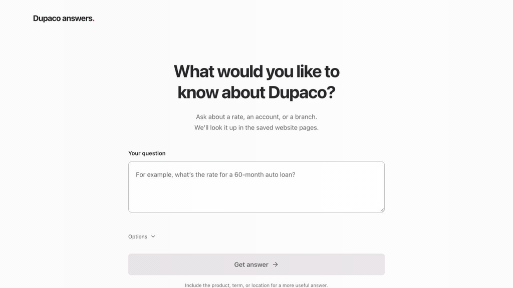

# Knowledge Desk

Ask questions about Dupaco’s accounts, rates, branches, and policies using five saved website snapshots. Answers show their sources and dates, support historical questions, and surface detected disagreements.

Built with React, TypeScript, and FastAPI. Runs locally without an LLM or API key. This repository is **public**; supplied snapshots, archives, evaluation inputs, and credentials are excluded.



*25-second demo using synthetic data. Displayed rates are illustrative, not actual offers.*

## Run with Docker

You need Git, Docker with Compose v2, and the organizer’s `hackathon-knowledge-kit-participant.zip`. The dataset is supplied separately; it is not included in the repository or image. These commands work in a POSIX shell on macOS, Linux, or Windows WSL.

**1. Clone and build the frontend and backend.**

```bash
git clone https://github.com/codestafa/interfaceai.git
cd interfaceai
docker compose build
```

**2. Import your local participant kit.** Replace the archive path below.

```bash
KIT_ARCHIVE="/absolute/path/to/hackathon-knowledge-kit-participant.zip"
mkdir -p data
docker run --rm --network none --read-only \
  --user "$(id -u):$(id -g)" \
  --mount "type=bind,source=$KIT_ARCHIVE,target=/kit/participant.zip,readonly" \
  --mount "type=bind,source=$(pwd)/data,target=/data" \
  knowledge-desk:local \
  python tools/import_kit.py /kit/participant.zip --destination /data --unpack
```

**3. Start the app.**

```bash
docker compose up -d --wait --wait-timeout 120
```

Open [localhost:8080](http://127.0.0.1:8080). Ask a question, then open **How we found this** to inspect its evidence. Include a date in the question or use **Options** for historical answers.

Stop with `docker compose down`; your local dataset is retained. See the [Docker guide](docs/docker.md) for existing datasets, custom ports, logs, updates, and troubleshooting. Building needs internet access; answering uses only local files.

## Results and limitations

Recorded on the supplied 40-question set: **95.74% QA**, **1.0 repeat consistency**, and **0.09 s answer p95**. The test suite has **127 passing tests**; frontend type checking, production builds, and container smoke checks pass.

This is a prototype. Known gaps remain in general policy contradictions, conflicts across snapshots, and complete savings-product lists. See [evaluation results and limitations](docs/evaluation.md) for the measurements and their scope.

## Project guide

| Location | Purpose |
| --- | --- |
| [frontend/](frontend/README.md) | React interface and frontend development |
| [backend/](backend/README.md) | FastAPI, MVC knowledge core, evaluator entrypoint, tests, and API reference |
| [tools/](tools/) | Dockerfile, kit importer, publication checks, and Git hooks |
| [docs/](docs/) | Detailed setup, architecture notes, and verification records |

Read [architecture and source-selection rules](docs/NOTES.md) or the [contribution and publication guide](docs/CONTRIBUTING.md). The browser and evaluator share the same knowledge controller. The app does not fetch live websites or save question history.
